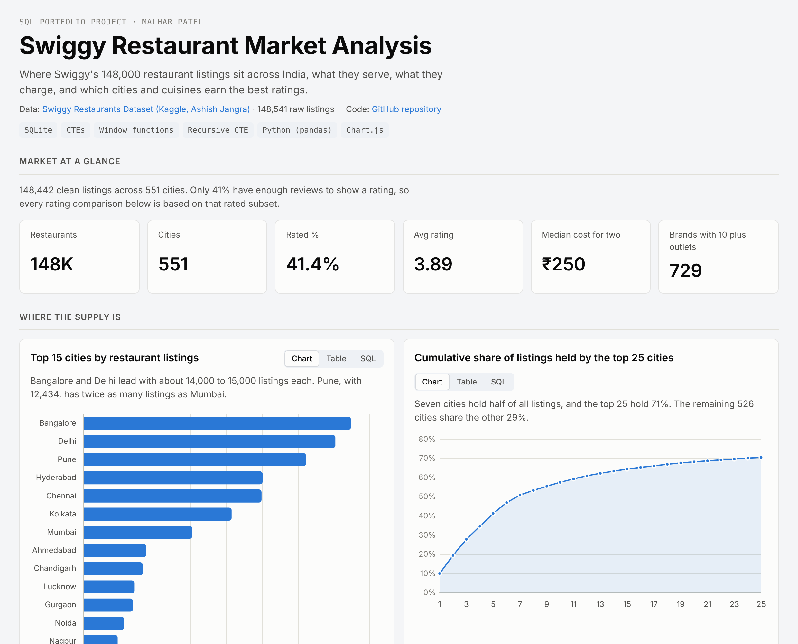
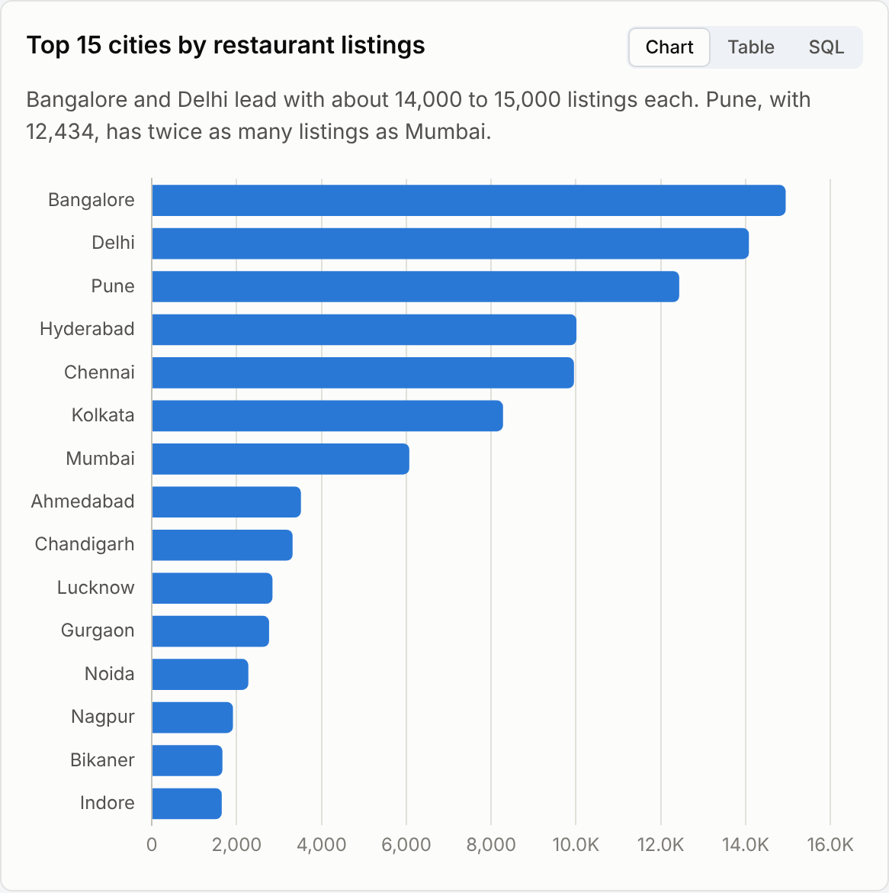
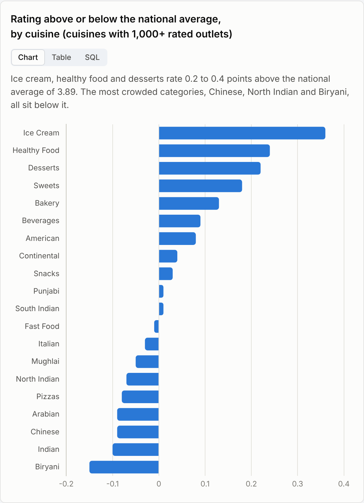
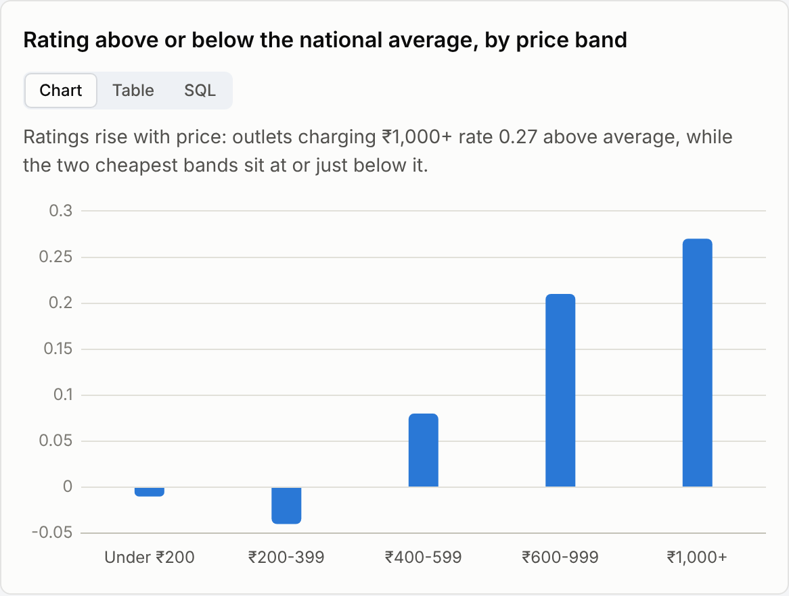
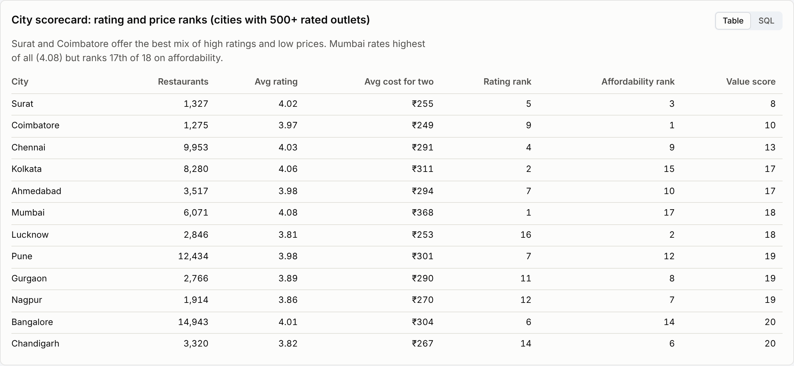
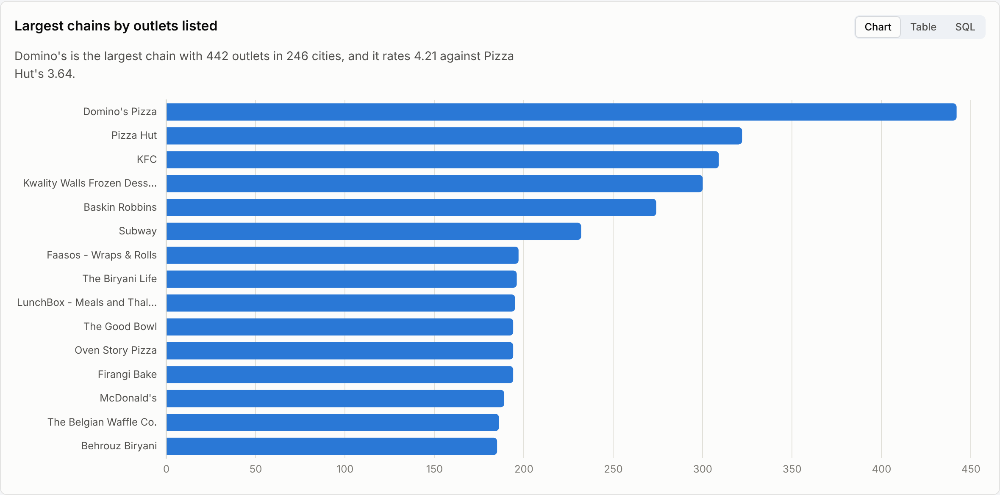

# Swiggy Restaurant Market Analysis (SQL)

Where Swiggy's 148,000 restaurant listings sit across India, what they serve, what they charge, and which cities, cuisines and chains earn the best ratings. Built in SQLite with CTEs, window functions and a recursive CTE, with an interactive dashboard.

**[Open the live dashboard](https://malharpatel78.github.io/swiggy-restaurant-sql-analysis/)**  ·  every chart has a SQL tab showing the exact query behind it.



## Business questions

1. Where is restaurant supply concentrated, by city and by neighbourhood?
2. Which cuisines dominate listings, and which ones earn above-average ratings?
3. Does a higher price point buy a better rating?
4. Which cities give customers the best mix of quality and price?
5. Which chains lead nationally and city by city, and how do they rate?

## Dataset

[Swiggy Restaurants Dataset](https://www.kaggle.com/datasets/ashishjangra27/swiggy-restaurants-dataset) on Kaggle (scraped from swiggy.com, 2023): 148,541 rows, one per listed outlet, with name, city, rating, review-count band, cost for two and cuisine tags. The raw file is in `data/swiggy.csv`.

## Data cleaning

The raw file needed more work than it looks. `sql/01_clean.sql` logs every fix in a `data_quality_log` table:

| Issue found | Rows | Fix |
|---|---:|---|
| Empty placeholder rows (every field is the text `NA`) | 86 | Dropped |
| Same outlet listed twice (name + area + address) | 13 | Kept the first id (`ROW_NUMBER`) |
| Rating shown as `--` (too few reviews) | 87,014 | Kept, rating set to NULL |
| City field holds `area,city` (e.g. `BTM,Bangalore`) | 101,712 | Split on the last comma into `area` and `city` |
| Cost for two missing or outside ₹50 to ₹5,000 | 437 | Cost set to NULL |
| Cuisine stored as a comma list (`Pizzas,Italian`) | all | Recursive CTE to one row per cuisine tag |
| Brand spelled several ways (`PIZZA HUT`, `Pizza Hut`) | all | Most common spelling per brand via `ROW_NUMBER` |

The city fix matters most. Grouping on the raw city column ranks Bikaner as India's biggest restaurant market, because Bangalore is split across dozens of `area,Bangalore` values. After the split, 821 raw "cities" collapse to 551 real ones and Bangalore and Delhi move to the top.

Result: 148,442 clean listings, of which 61,435 (41%) carry a rating.

## Key findings

**1. Seven cities hold half of all listings.** Bangalore (14,943) and Delhi (14,076) lead, and Pune (12,434) has twice as many listings as Mumbai. The top 25 cities hold 71% of supply; the other 526 cities share the remaining 29%.



**2. Most listings have no rating yet.** Only 41% of outlets have enough reviews to show a score. In Gurgaon, Lucknow and Nagpur it is under 30%, which limits how much a customer can learn before ordering.

**3. Indo-Chinese is the default menu, but not the best rated.** Chinese is tagged on 24.6% of listings, ahead of North Indian (21.9%). Yet Chinese, North Indian and Biryani all rate below the national average of 3.89, while ice cream (+0.36), healthy food (+0.24) and desserts (+0.22) rate well above it.



**4. Price buys a modest rating lift.** Two in three outlets charge ₹200 to ₹399 for two. Outlets charging ₹1,000+ rate 0.27 above average and those under ₹400 sit at or just below it. More-reviewed outlets also rate higher: 1,000+ reviews rate 0.16 above average, 20+ reviews 0.14 below.



**5. Surat and Coimbatore are the best-value cities.** Ranking 18 large cities on rating and on average cost, Surat (4.02 rating, ₹255 for two) and Coimbatore (3.97, ₹249) come out on top. Mumbai rates highest (4.08) but is the second most expensive.



**6. Domino's leads nationally; local brands lead several cities.** Domino's has 442 outlets in 246 cities and rates 4.21, against Pizza Hut's 3.64. It is the biggest chain in Chennai, Pune and Hyderabad, but Five Star Chicken leads Bangalore, Wow! Momo leads Kolkata and Lucknow, and Tea Post leads Ahmedabad.



## Recommendations

- **Grow ratings coverage in low-review cities.** With 59% of outlets unrated, a post-delivery rating prompt targeted at Gurgaon, Lucknow and Nagpur would give customers more signal and give the ranking algorithm more to work with.
- **Recruit premium and dessert partners.** These categories rate highest but make up a small share of supply (only 4.7% of outlets charge ₹600+). They lift the average quality customers see.
- **Run quality programmes for the biggest categories.** Chinese, North Indian and Biryani are where most orders sit and where ratings trail the average, so a small improvement there moves the most customers.
- **Use Surat and Coimbatore as value case studies** for campaigns in price-sensitive cities.

## SQL techniques used

| Technique | Where |
|---|---|
| CTEs and multi-step pipelines | every analysis query |
| `ROW_NUMBER()` for de-duplication and "top 1 per group" | `01_clean.sql`, `city_leaders` |
| Running totals with `SUM() OVER (ORDER BY ...)` | `city_concentration` |
| `RANK()` / `DENSE_RANK()` scorecards | `city_value`, `chain_quality` |
| Median without a MEDIAN function | `overview` |
| Recursive CTE to split comma lists into rows | `restaurant_cuisines` in `01_clean.sql` |
| String parsing with `INSTR`, `SUBSTR`, `RTRIM` | city/area split |
| `CASE` bucketing and `CROSS JOIN` benchmarks | price bands, rating gap vs national average |

## Repository structure

```
data/swiggy.csv            raw Kaggle file
sql/01_clean.sql           profiling, cleaning, data quality log
sql/02_analysis.sql        16 analysis queries, each tagged with a title and insight
results/*.csv              output of every query
docs/index.html            interactive dashboard (GitHub Pages)
scripts/build.py           loads the CSV into SQLite, runs the SQL, builds the dashboard
images/                    dashboard screenshots used in this README
```

## How to run

```bash
pip install pandas
python scripts/build.py      # creates data/swiggy.db, results/, docs/index.html
```

Or open DB Browser for SQLite, import `data/swiggy.csv` as a table named `swiggy_raw`, then run `sql/01_clean.sql` followed by the queries in `sql/02_analysis.sql`.

## Resume line

> Analysed 148,000+ Swiggy restaurant listings across 551 Indian cities in SQL (CTEs, window functions, recursive CTE); fixed a city-field error that misranked markets, and built an interactive dashboard showing 7 cities hold 50% of supply and premium outlets rate 0.27 points above average.

---
Malhar Patel · MS Marketing Analytics & Insights, Rutgers Business School · [LinkedIn](https://www.linkedin.com/in/malharpatel0911)
